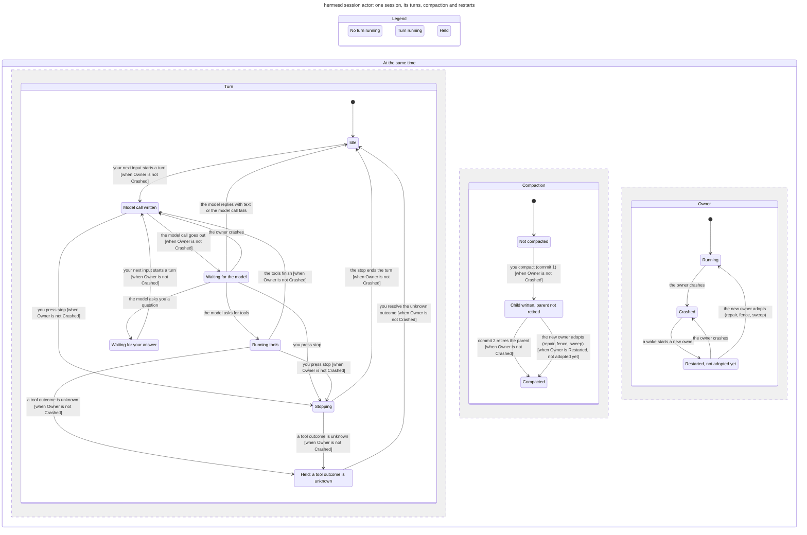

# Session loop statechart

A TLA+ model of one session actor (`packages/session-actor/src/actor.ts`, `loop.ts`,
`lineage.ts`, `packages/runtime/src/session.ts`): its turns, the stop and clarify paths, an
unknown tool outcome, the two-commit compaction, and a crash with a new owner. TLC checks the
rules below on every state; the chart is drawn from the same run.



## Rules

| Rule | In words | Status |
|---|---|---|
| `CallsAnswered` | When no turn runs, every tool call has its result, except the clarify call that waits for you. | holds |
| `HeldMeansNoTurn` | While a tool outcome is unknown, no model call is out. | holds |
| `NoLostMessage` | Every message a turn writes lands in the session that is current, so the model sees it next time. | holds since the fix below |

`NoLostMessage` broke on the code before this commit. Path: you send a message, the turn
starts, the model call goes out, you compact (commit 1 makes the child current), the model
replies. The step wrote the reply to `snap.sessionId`, the parent read before the fetch, so the
reply sat in the retired parent and the child never saw it. `packages/faults/src/loop/compact-race.test.ts`
replays that path; the step now reads the current session inside its commit. Set
`WriteTarget == callSess` in the spec to see the old path again.

## What the model leaves out

One queued input at a time, one compaction, no in-turn window compression (`writeWindowChild`),
no fallback model, no retries or wake obligations (a crash just loses the fetch and the next
wake resends it), no executor fence or sweep detail beyond "adopt". The chart hides no steps;
"you send a message" stays in one chart state, so it has no arrow.

## Make it again

With the statechart skill (https://github.com/cursor/plugins/tree/main/pstack/skills/statechart):

```sh
<skill dir>/scripts/statechart docs/statecharts/session-loop/SessionLoop.tla \
  --view docs/statecharts/session-loop/view.ts --out /tmp/session-loop-chart
```

Set `TLA2TOOLS` (tla2tools.jar 1.7.4) and `JAVA` to skip the mise install.
Copy the new `chart.mmd` here and into the block above.
